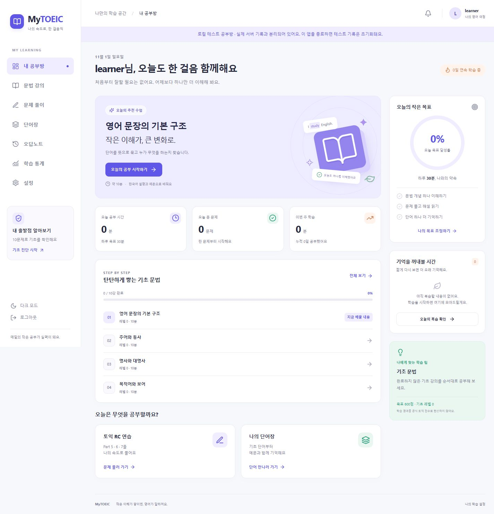
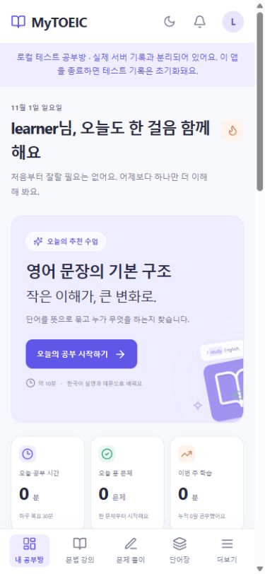
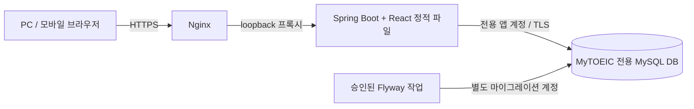

# MyTOEIC

영어 왕초보가 문장 구조부터 TOEIC RC까지 자신의 속도로 공부하는 개인 학습 웹사이트입니다. 한국어 문법 설명, 단어 암기, 문제 풀이와 복습을 하나의 계정으로 연결합니다.

**사이트:** [mytoeicstudy.duckdns.org](https://mytoeicstudy.duckdns.org)

> 운영 사이트는 개인 계정으로 사용합니다. 공개 회원가입과 공개 체험 계정은 제공하지 않습니다. 아래의 격리된 로컬 체험 모드로 화면과 기능을 확인할 수 있습니다.



<details>
<summary>모바일 화면 보기</summary>



</details>

## 주요 기능

| 기능 | 제공 내용 |
|---|---|
| 나의 공부방 | 목표 달성률, 학습량, 연속 학습일, 다음 강의와 복습 추천 |
| 기초 문법 | 한국어 강의, 쉬운 재설명, 예문 번역과 문장 성분 분석, 연습 문제와 진도 저장 |
| TOEIC RC | Part 5 유형별 연습, Part 6 빈칸 지문, Part 7 단일·이중·삼중 지문 |
| 정답과 해설 | 제출 후 정답·전체 번역·선택지별 해설 확인, 문제 북마크 |
| 단어 학습 | 검색, 개인 단어장, 카드 학습, 뜻 맞히기, 암기 상태와 복습 일정 |
| 오답과 복습 | 자동 오답 저장, 재풀이, 해결 상태, 과거 풀이 이력 보존 |
| 학습 통계 | 7·30·90일 학습량, 파트·유형별 정답률, 목표와 시간대 설정 |
| 기초 진단 | 10문항 진단, 이어풀기, 유형별 결과와 관련 강의 |
| 모바일 | 반응형 화면, 다크모드, PWA 아이콘과 오프라인 안내 |

같은 계정으로 PC와 휴대폰에서 학습 기록을 이어갑니다. 추천과 진단은 규칙 기반이며 공식 TOEIC 점수를 예측하지 않습니다. 외부 유료 AI API나 동영상 서비스는 사용하지 않습니다.

## 초기 학습 콘텐츠

| 콘텐츠 | 수량 |
|---|---:|
| 왕초보 문법 강의 | 10강 |
| 문법 예문 / 연습 문제 | 30개 / 20문제 |
| 기초 단어 | 200개 |
| Part 5 | 50문제 |
| Part 6 | 4세트 · 16문제 |
| Part 7 | 8세트 · 30문제 |
| RC 지문 | 16개 |

RC 96문제와 문법 연습 20문제로 총 116문제입니다. 단어에는 품사·뜻·예문·번역을, 문제에는 정답과 각 선택지의 한국어 해설을 제공합니다. 자료는 자체 제작했으며 공식 기출문제를 복제하지 않았습니다. 현재는 초기 학습 분량이며, 독립된 영어 교육 전문가의 감수는 받지 않았습니다.

## 기술 스택과 구성

| 구분 | 기술 |
|---|---|
| Frontend | React 19, TypeScript, Vite 7, Tailwind CSS 4 |
| Backend | Java 17, Spring Boot 3.5.16, Spring Data JPA, Spring Security, Bean Validation |
| Database | MySQL 8.0, Flyway |
| 인증 | 세션 쿠키, CSRF, BCrypt |
| 배포 | Ubuntu, Docker, Nginx, DuckDNS, Let's Encrypt / Certbot |
| 검증 | JUnit, H2, Testcontainers MySQL, Vitest, GitHub Actions |



React 빌드를 Spring Boot JAR에 포함해 화면과 API를 같은 출처로 제공합니다. 기존 서버의 MySQL을 재사용하되 전용 DB와 계정으로 분리했습니다.

## 빠르게 체험하기 — 운영 DB 연결 없이

Java 17, Node.js 22 이상이 필요합니다. 처음 실행할 때 의존성 다운로드를 위한 인터넷 연결이 필요합니다.

```bash
cd frontend
npm ci
npm run build
cd ../backend
```

Windows PowerShell:

```powershell
.\gradlew.bat webTestRun
```

Linux / macOS:

```bash
bash gradlew webTestRun
```

[http://localhost:18081](http://localhost:18081)에 접속합니다.

- 체험 아이디: `learner`
- 체험 비밀번호: `test-only-LongPassword!27`

이 계정은 **격리된 H2 메모리 DB 전용**입니다. 운영 DB에 접속하지 않으며 화면에 테스트 모드가 표시됩니다. 앱 종료 시 체험 기록이 사라집니다.

## 실제 DB 연결과 최초 계정

1. 전용 DB와 마이그레이션·앱 계정을 준비합니다. [DB 운영 문서](docs/DATABASE_OPERATIONS.md)와 [런타임 권한 SQL](infra/mysql/runtime-grants.sql)을 참고하세요.
2. 로컬 직접 접속은 `backend/src/main/resources/application.yml.example`을 같은 위치의 `application.yml`로 복사하고 비공개 파일에 실제 연결 정보를 설정합니다. [YAML 연결 절차](docs/LOCAL_SERVER_DB.md)에 예시가 있습니다.
3. 현재 Flyway 버전과 백업을 확인한 뒤 승인된 경우에만 마이그레이션합니다. 신규 설치는 V1~V5를 적용하며 **현재 운영 DB는 V4**입니다.
4. 앱 실행에는 앱 계정을 사용하고 Flyway를 끕니다.
5. Windows에서는 프로젝트 루트에서 `./scripts/start-study.ps1`을 실행합니다. 비공개 `private/study-access.html`의 링크로 첫 계정을 만듭니다.

사이트 비밀번호는 16자 이상·UTF-8 72바이트 이하입니다. 최초 계정 생성에는 설치 토큰과 CSRF가 필요하며 계정이 하나라도 있으면 최초 설정 API로 추가 계정을 만들 수 없습니다. 설정 링크는 공유하지 않습니다.

운영 JAR는 개인 YAML 대신 공개 템플릿을 포함하므로 서버에 별도의 비공개 설정을 제공해야 합니다. Compose 설치와 기존 DB 연결 방법은 [배포 문서](docs/DEPLOYMENT.md), [웹 앱 안내](docs/WEB_APP.md), [DB 운영 문서](docs/DATABASE_OPERATIONS.md)를 참고하세요.

## 테스트와 패키징

프론트엔드:

```bash
cd frontend
npm ci
npm test
npm run build
```

백엔드 — `backend` 디렉터리에서:

```powershell
# Windows
.\gradlew.bat test mysqlTest bootJar
```

```bash
# Linux / macOS
bash gradlew test mysqlTest bootJar
```

`mysqlTest`에는 Docker가 필요합니다. 임시 MySQL 컨테이너와 임의 포트를 사용하며 운영 DB를 사용하지 않습니다. 결과 JAR는 `backend/build/libs/mytoeic-0.3.0.jar`입니다.

기존 검증에서 백엔드 70개·프론트엔드 7개가 통과했습니다. 마이그레이션 반복 실행, 최소 권한, 백업·복원, 이전 학습 기록과 스냅샷 보존, 인증·CSRF, 중복 제출, 페이지 조회 쿼리 수를 검증했습니다. 범위와 시점은 [검증 기록](docs/VALIDATION.md)을 참고하세요. GitHub Actions에는 콘텐츠 SQL 일치 검사, 프론트 테스트·빌드, H2·임시 MySQL 테스트와 JAR 패키징을 정의했습니다.

## 데이터 설계와 보존

- 업무 테이블 26개에 PK·FK·UNIQUE·인덱스를 정의했습니다. [ERD](docs/ERD.md)와 [테이블 정의서](docs/TABLES.md)를 제공합니다.
- JPA는 `ddl-auto=validate`, `open-in-view=false`를 사용합니다. Flyway clean과 자동 baseline은 비활성화합니다.
- 풀이·학습·암기 이벤트를 누적하고 문제·선택지·해설·단어의 당시 내용을 스냅샷으로 보존합니다.
- 오답을 해결해도 이전 풀이를 삭제하지 않습니다. 제출 키와 트랜잭션으로 중복 집계를 방지합니다.
- 런타임에는 필요한 테이블별 권한만 부여하고 마이그레이션 계정을 분리합니다.
- 적용한 마이그레이션은 수정하지 않습니다. 원본은 `content/`에 있으며 변경은 새 Flyway 버전으로 배포합니다.

## 운영 상태

2026-11-01 기준, 사용자가 서버에서 HTTPS health 응답 `UP`, Certbot 갱신 모의 실행 성공, 앱 재시작 정책, Docker·Nginx·인증서 갱신 타이머·HTTPS 방화벽 서비스의 자동 시작 설정을 확인했습니다. 첫 사이트 계정도 생성했습니다.

**V5 콘텐츠 보완 3건은 코드와 테스트만 준비했으며 운영 DB 적용은 보류 중입니다.** 소스 업로드나 JAR 교체만으로 마이그레이션하지 않습니다. 별도 승인과 백업이 필요합니다. 운영에는 직전 검증한 0.3.0 JAR가 배포돼 있으며 이후 소스의 경미한 글자 크기 보정은 다음 빌드에 포함됩니다.

## 디렉터리와 문서

```text
frontend/       React 화면과 프론트 테스트
backend/        API · Entity · Repository · Service · DTO · Flyway · 테스트
content/        강의 · 단어 · 문제 원본 및 정정 내용
infra/          MySQL 권한 SQL · Nginx 설정 예시
scripts/        콘텐츠 검사 · 시드 생성 · 백업 · 복원 · 로컬 실행
docs/           설계 · API · 실행 · 운영 · 검증 문서
.github/        CI 워크플로
```

| 문서 | 내용 |
|---|---|
| [웹 앱 안내](docs/WEB_APP.md) | 화면별 기능, 최초 계정, 개발·빌드 |
| [배포 및 HTTPS](docs/DEPLOYMENT.md) | 서버 설정, Nginx, 인증서, 운영 점검 |
| [아키텍처](docs/ARCHITECTURE.md) | 전체 구조와 학습 단계 |
| [ERD](docs/ERD.md) / [테이블 정의](docs/TABLES.md) | 관계와 제약조건 |
| [REST API](docs/API.md) | 인증, 요청과 응답 |
| [DB 운영](docs/DATABASE_OPERATIONS.md) | 설치, 마이그레이션, 백업과 새 DB 복원 |
| [서버 DB 적용 기록](docs/SERVER_DB_APPLIED.md) | V4 적용과 원본 보존 확인 |
| [콘텐츠 품질](docs/CONTENT_QUALITY.md) | 검사 범위와 V5 정정 |
| [검증 결과](docs/VALIDATION.md) | 테스트와 브라우저 검증 범위 |

실제 DB 비밀번호·서버 접속 설정·개인키·설치 토큰·DB 백업은 저장소에 포함하지 않습니다. `.env.example`과 `*.example`은 공개용 템플릿입니다. PWA는 개인 API 응답을 캐시하지 않으며 실제 학습과 로그인에는 네트워크 연결이 필요합니다.
