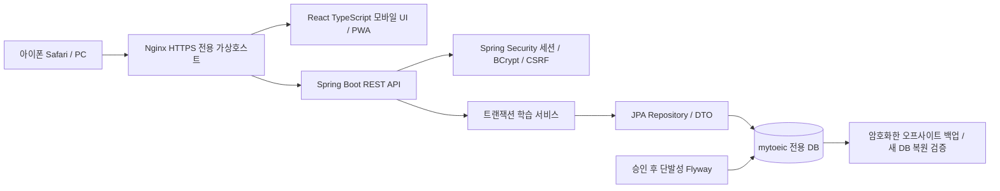

# 전체 시스템과 단계

## 현재 구현

0.3.0은 React·TypeScript·Vite·Tailwind 학습 화면을 Spring Boot의 실제 인증·학습 API에 연결한다. 강의·문제·단어·오답·복습·통계·설정·진단과 PWA 설치 파일을 포함하고 정적 빌드는 JAR와 함께 배포한다. 개인 서버 MySQL 8.0.46의 전용 DB는 V4까지 설치되어 있다. 사용자의 지시에 따라 내용 보완 V5는 코드에만 준비했으며 서버에는 적용하지 않았다. 앱 실행용 계정 준비와 Linux 앱·HTTPS 배포는 남아 있다. [현재 웹사이트 실행 안내](WEB_APP.md)가 우선하는 운영 절차다.

개인 Linux 서버의 DB 재사용이 우선이다. `compose.yml`은 새 로컬 테스트용 DB이고, `compose.existing-db.yml`은 기존 DB를 사용하는 백엔드만 띄운다. 둘 다 별도의 Compose 프로젝트 이름을 사용한다. Nginx는 새 가상호스트 설정 템플릿만 제공하며 기존 서비스 설정을 덮어쓰지 않는다.

## 데이터 흐름과 보존

1. 관리자 초기화는 환경변수로 명시적으로 켜고 계정이 없을 때만 생성한다. 회원가입은 제공하지 않는다.
2. 로그인은 BCrypt 검증과 서버 세션을 사용한다. 모든 상태 변경은 CSRF 토큰이 필요하다. 세션은 기본 14일 무활동 만료이며 현재 서버 메모리에 저장되어 백엔드 재시작 시 재로그인이 필요하다. 학습 DB 데이터는 유지된다.
3. 문제 조회에는 정답·해설·번역을 넣지 않는다. 제출 시 선택지가 해당 문항에 속하는지 검증하고 채점 결과·스냅샷·오답 상태·복습 일정·통계를 하나의 트랜잭션으로 저장한다.
4. 사용자 행의 비관적 잠금으로 개인별 쓰기를 직렬화한다. 이벤트별 `(user_id, request_key)` UNIQUE가 재시도 중복을 막는다. 진단 문항은 회차별 1회 제출만 허용한다.
5. JPA 변경 감지와 `@Version`을 사용하며 원본 이벤트에는 런타임 DB 계정의 UPDATE/DELETE 권한을 부여하지 않는다. 콘텐츠는 읽기 전용이다.
6. 통계는 저장된 이벤트의 학습일을 기준으로 집계한다. 일일 통계는 읽기 성능을 위한 파생 데이터다. 표준 이벤트 3종(강의/문제/단어)의 합과 일치하는지 운영 점검한다.

## 조회 성능

- Open Session in View 비활성화, 서비스 트랜잭션 안에서 DTO 변환.
- 문제 페이지의 선택지는 IN 쿼리 한 번으로 로딩. 20문항 페이지 SQL 수 상한을 테스트한다.
- 단어장·오답·북마크·복습 일정 조회는 EntityGraph로 필요한 to-one 관계를 함께 로딩한다. 컬렉션 fetch join과 페이지네이션을 섞지 않는다.
- API 페이지 크기 1~100, 통계 범위 최대 367일. 사용자·날짜, 복습 기한, 문제 종류/난이도, 최신 풀이 조회에 복합 인덱스.
- 상세 문제는 문항·선택지·정답을 목적에 따라 개별 조회한다. 진단 시험 목록의 문항 수는 시험별 조회이므로 향후 시험이 다수로 늘면 GROUP BY 집계로 전환할 수 있다.
- 학습 이력은 무기한 증가하므로 대규모 서비스로 확장할 때 연도별 보관·키셋 페이지네이션·집계 작업을 추가한다. 현재 대상은 개인 1명이다.

## 화면 구성 계획

| 화면 | 학습자의 작업 | 연결 API |
|---|---|---|
| 홈 | 오늘 목표, 주간 학습량, 추천과 복습 | dashboard, reviews/due |
| 문법 강의 | 한국어 설명, 예문 분석, 쉬운 재설명, 진도 | lessons, progress |
| 문제 풀이 | Part 5·6·7, 단일/이중/삼중 지문, 4지선다, 제출 후 해설·번역 | questions, reading-sets, attempts |
| 단어장 | 단어 카드, 개인 저장, 기억 여부 | words, notebook, word-reviews |
| 오답노트 | 최초/최근 오답, 재풀이, 연관 강의 | wrong-notes, questions, lessons |
| 학습 통계 | 일별 활동, 유형별 정답률, 연속 학습일 | stats, dashboard |
| 설정·목표·진단 | 시간대, 하루 목표, 목표 점수, 기초 진단 | settings, goals, level-tests |

현재 UI는 흰색 배경·블루/퍼플 포인트·큰 학습 본문·넉넉한 행간·하단 탐색·다크모드·모바일 반응형이다. 문제 번역은 제출 후에 공개한다. PWA 캐시에는 로그인 응답·개인 학습 데이터·정답 API를 저장하지 않으며 오프라인 안내만 제공한다.

## 단계와 완료 기준

| 단계 | 상태 / 완료 기준 |
|---|---|
| DB·인증·학습 백엔드 | 이번 구현. 마이그레이션, 계정, 학습 API, 초기 콘텐츠, MySQL 테스트 |
| 모바일 UI | 구현·브라우저 검증 완료. 실제 iPhone Safari 기기 검증은 대기 |
| 학습 흐름 | 강의→재설명→예문→확인 문제→해설→진도·복습 저장 검증 |
| 추천·통계 화면과 PWA | 실제 집계와 추천 연결, 다크모드, manifest·아이콘·오프라인 안내 구현 |
| 개인 서버 연결 | 전용 DB V4 설치·백업 복원·기존 행 보존 확인. 앱 실행용 계정 설정과 앱 배포 대기 |
| GitHub·HTTPS 배포 | 대기. 비밀정보 점검, 사용자 push 승인, 포트·가상호스트 확인과 배포 승인 |
| RC 전체 | Part 5·6·7 문제·지문·채점·번역·해설·북마크·이력·통계 화면 구현 |
| LC | 향후. 음원 데이터 모델·재생·접근성 추가 |

## 예상 운영 비용

현재 개인 서버를 재사용하므로 신규 서버 구매는 기본 계획에 포함하지 않는다. 코드가 외부 AI API를 호출하지 않아 AI 호출 사용량은 0이다. 실제 추가 지출은 도메인 선택, 서버의 전기/트래픽 계약, 백업 저장소 용량과 보관 정책에 달려 있다. 아직 서버 사양·백업 서비스·도메인 제공자가 정해지지 않아 월 정액을 확정하지 않는다. 연결 후 CPU·메모리·디스크·DB 증가량을 측정해 백업 용량과 서버 증설 필요성을 판단한다.
