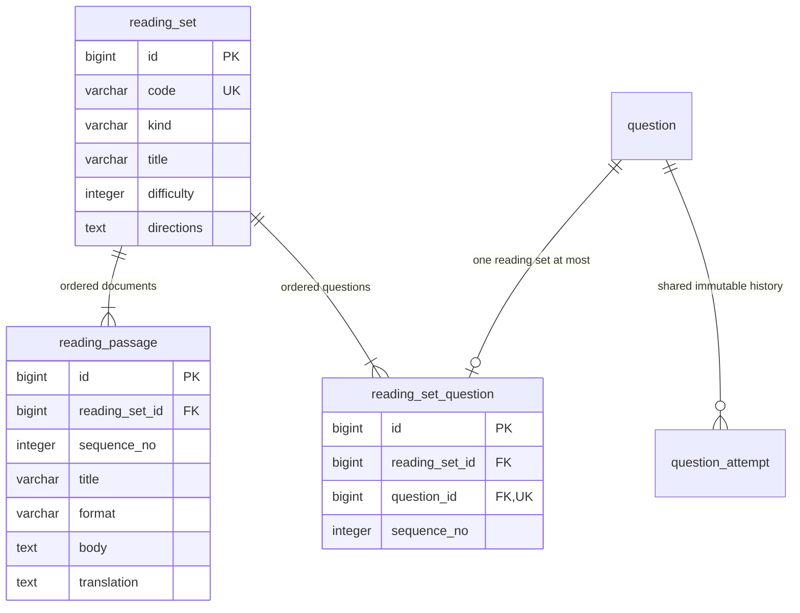

# MyTOEIC ERD

```mermaid
erDiagram
    user_account {
        bigint id PK
        varchar username
        varchar password_hash
        boolean active
    }
    user_setting {
        bigint id PK
        bigint user_id FK
        integer target_score
        integer daily_minutes
        varchar timezone
        integer learning_level
    }
    user_account ||--o| user_setting : "user"
    grammar_lesson {
        bigint id PK
        varchar code
        varchar title
        integer level
        integer sort_order
        integer estimated_minutes
        integer revision
        text objective
        text content
        text easier_explanation
        text summary
    }
    grammar_example {
        bigint id PK
        bigint lesson_id FK
        integer sequence_no
        varchar sentence
        varchar translation
        text analysis
        text explanation
    }
    grammar_lesson ||--o{ grammar_example : "lesson"
    question {
        bigint id PK
        varchar code
        bigint lesson_id FK
        varchar kind
        integer difficulty
        varchar grammar_type
        text prompt
        text translation
        integer revision
        boolean active
    }
    grammar_lesson ||--o{ question : "lesson"
    question_option {
        bigint id PK
        bigint question_id FK
        varchar option_key
        varchar content
        text explanation
    }
    question ||--o{ question_option : "question"
    question_answer {
        bigint id PK
        bigint question_id FK
        bigint correct_option_id FK
        text explanation
    }
    question ||--o| question_answer : "question"
    question_option ||--o{ question_answer : "correctOption"
    vocabulary {
        bigint id PK
        varchar code
        varchar word
        varchar part_of_speech
        varchar meaning
        varchar example
        varchar translation
        integer level
    }
    lesson_progress {
        bigint id PK
        bigint user_id FK
        bigint lesson_id FK
        integer percent
        datetime completed_at
    }
    user_account ||--o{ lesson_progress : "user"
    grammar_lesson ||--o{ lesson_progress : "lesson"
    lesson_study_event {
        bigint id PK
        bigint user_id FK
        bigint lesson_id FK
        integer percent
        integer elapsed_seconds
        date learning_date
        varchar request_key
    }
    user_account ||--o{ lesson_study_event : "user"
    grammar_lesson ||--o{ lesson_study_event : "lesson"
    level_test {
        bigint id PK
        varchar code
        varchar title
        boolean active
    }
    level_test_question {
        bigint id PK
        bigint test_id FK
        bigint question_id FK
        integer sequence_no
    }
    level_test ||--o{ level_test_question : "test"
    question ||--o{ level_test_question : "question"
    level_test_run {
        bigint id PK
        bigint user_id FK
        bigint test_id FK
        varchar status
        datetime completed_at
        integer recommended_level
        varchar request_key
    }
    user_account ||--o{ level_test_run : "user"
    level_test ||--o{ level_test_run : "test"
    question_attempt {
        bigint id PK
        bigint user_id FK
        bigint question_id FK
        bigint selected_option_id FK
        bigint test_run_id FK
        boolean correct
        integer elapsed_seconds
        integer question_revision
        text question_snapshot
        text answer_snapshot
        date learning_date
        varchar request_key
    }
    user_account ||--o{ question_attempt : "user"
    question ||--o{ question_attempt : "question"
    question_option ||--o{ question_attempt : "selectedOption"
    level_test_run ||--o{ question_attempt : "testRun"
    user_vocabulary {
        bigint id PK
        bigint user_id FK
        bigint vocabulary_id FK
        varchar status
    }
    user_account ||--o{ user_vocabulary : "user"
    vocabulary ||--o{ user_vocabulary : "vocabulary"
    word_review {
        bigint id PK
        bigint user_id FK
        bigint user_vocabulary_id FK
        boolean remembered
        integer elapsed_seconds
        text word_snapshot
        date learning_date
        varchar request_key
    }
    user_account ||--o{ word_review : "user"
    user_vocabulary ||--o{ word_review : "userVocabulary"
    wrong_note {
        bigint id PK
        bigint user_id FK
        bigint question_id FK
        bigint first_attempt_id FK
        bigint last_attempt_id FK
        integer error_count
        boolean resolved
    }
    user_account ||--o{ wrong_note : "user"
    question ||--o{ wrong_note : "question"
    question_attempt ||--o{ wrong_note : "firstAttempt"
    question_attempt ||--o{ wrong_note : "lastAttempt"
    question_bookmark {
        bigint id PK
        bigint user_id FK
        bigint question_id FK
    }
    user_account ||--o{ question_bookmark : "user"
    question ||--o{ question_bookmark : "question"
    review_schedule {
        bigint id PK
        bigint user_id FK
        bigint lesson_id FK
        bigint question_id FK
        bigint user_vocabulary_id FK
        datetime due_at
        integer streak
        boolean active
    }
    user_account ||--o{ review_schedule : "user"
    grammar_lesson ||--o{ review_schedule : "lesson"
    question ||--o{ review_schedule : "question"
    user_vocabulary ||--o{ review_schedule : "userVocabulary"
    review_event {
        bigint id PK
        bigint user_id FK
        bigint schedule_id FK
        boolean successful
        integer interval_days
        datetime next_due_at
        varchar request_key
    }
    user_account ||--o{ review_event : "user"
    review_schedule ||--o{ review_event : "schedule"
    learning_daily_stat {
        bigint id PK
        bigint user_id FK
        date learning_date
        integer study_seconds
        integer attempts
        integer correct_answers
        integer lesson_events
        integer word_reviews
    }
    user_account ||--o{ learning_daily_stat : "user"
    learning_goal {
        bigint id PK
        bigint user_id FK
        integer target_score
        integer daily_minutes
        date starts_on
        date ends_on
        boolean active
    }
    user_account ||--o{ learning_goal : "user"
    diagnostic_result {
        bigint id PK
        bigint run_id FK
        varchar grammar_type
        integer total_questions
        integer correct_answers
        text recommendation
    }
    level_test_run ||--o{ diagnostic_result : "run"
```

논리적 1:1은 FK의 UNIQUE로 강제한다. review_schedule은 세 대상 중 하나만 허용하는 CHECK가 있다. question_answer와 question_attempt는 복합 FK로 선택지가 해당 문제에 속하는지 보장한다.

## V3: RC 지문 확장 (총 26개 테이블)

기존 V1 테이블을 재작성하지 않고 지문 구조 3개를 추가한다. 기존 question.kind CHECK에 PART6/PART7을 허용한다.

지문·문항 순서는 각각 `(reading_set_id,sequence_no)` UNIQUE다. Part 6은 지문 1개·문항 4개, Part 7은 지문 1~3개를 한 세트로 묶으며 시드 생성기에서 구성 조건을 검증한다. 각 세트의 최소 문항 수는 SQL FK가 강제하지 않으므로 관리자 콘텐츠 추가도 동일한 검증을 거친다. 풀이 저장 시 reading_set을 따라 현재 지문을 다시 참조하지 않고, 전체 지문·번역을 당시 스냅샷에 포함한다.
